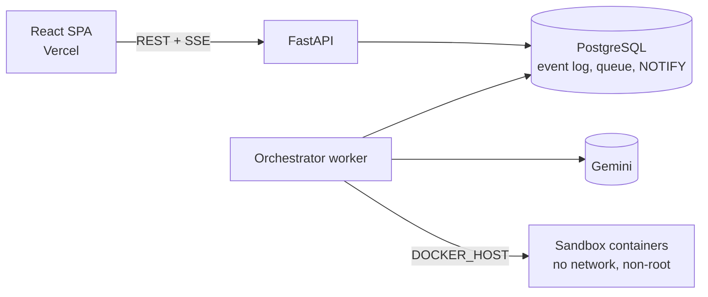

# AGENT-P

**An execution and observability platform for real AI agent workflows.**

Give AGENT-P an engineering task against a Python repository — *"this endpoint is slow, find out why, fix it, and prove the fix works"* — and watch a coordinator and specialized agents plan, inspect code through permissioned tools, propose a patch, wait for your approval, and verify the result in an isolated sandbox. Every step is a persisted, ordered event, so the live graph, the replay, and the final report all tell the same, verifiable story.

> Status: early development. Architecture, event log, API and UI shell are in place; agent execution is next. See the [roadmap](docs/IMPLEMENTATION_ROADMAP.md).

## Why

Agent tools tend to be opaque (a chat box) or low-level (span traces). AGENT-P focuses on:

- **Evidence over claims.** "Verified" is computed from sandbox exit codes and test/benchmark output, never from model text.
- **Workflow-level visibility.** Dependencies, states, retries, and hand-offs between agents, live.
- **Human control.** Patches are only applied after explicit approval.
- **Deterministic replay.** Completed runs replay from stored events; the model is never called again.
- **Security by design.** A model's tool request is a proposal, validated and permission-checked before anything runs.

## Architecture



A modular monolith: one Python codebase with an `api` process and a `worker` process, PostgreSQL as the system of record *and* the coordination layer (`SKIP LOCKED` queue, `LISTEN/NOTIFY` fan-out). Details: [ARCHITECTURE.md](docs/ARCHITECTURE.md).

## Stack

**Frontend:** Vite, React 19, TypeScript, Tailwind v4, React Flow + ELK, TanStack Query, Zustand · **Backend:** Python 3.12, FastAPI, Pydantic v2, SQLAlchemy 2 (async), Alembic, PostgreSQL 16, SSE · **LLM:** Gemini (`gemini-3.8-flash`) behind a provider interface · **Infra:** Docker (Colima locally), GitHub Actions, Vercel, OCI Ampere VM. See [TECH_STACK.md](docs/TECH_STACK.md).

## Getting started

See [docs/LOCAL_DEVELOPMENT.md](docs/LOCAL_DEVELOPMENT.md). In short:

```bash
docker compose up -d postgres
cd backend && cp .env.example .env && uv run alembic upgrade head && uv run agentp api --reload
cd frontend && npm install && npm run dev
```

## Documentation

| | |
|---|---|
| [Product requirements](docs/PRODUCT_REQUIREMENTS.md) | Users, problem, functional/non-functional requirements, acceptance criteria |
| [MVP scope](docs/MVP_SCOPE.md) · [Roadmap](docs/IMPLEMENTATION_ROADMAP.md) | What's in, what's deferred, milestones |
| [Architecture](docs/ARCHITECTURE.md) · [Decisions](docs/ARCHITECTURE_DECISIONS/) | Diagrams, lifecycle, trade-offs, ADRs |
| [Database](docs/DATABASE_DESIGN.md) · [API](docs/API_SPECIFICATION.md) | Schema, endpoints, event schema |
| [Security model](docs/SECURITY_MODEL.md) | Threat model, sandbox controls, residual risks |
| [Design system](docs/DESIGN_SYSTEM.md) | Tokens, screens, components |

## License

To be decided before the first public release.
