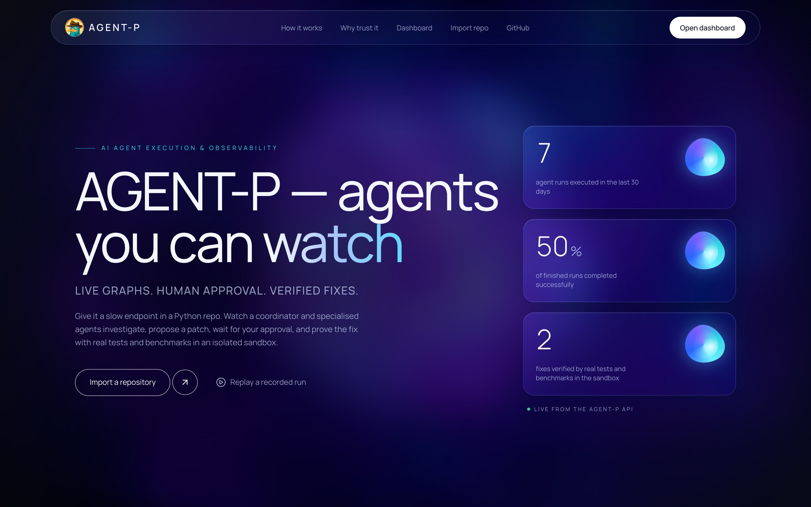
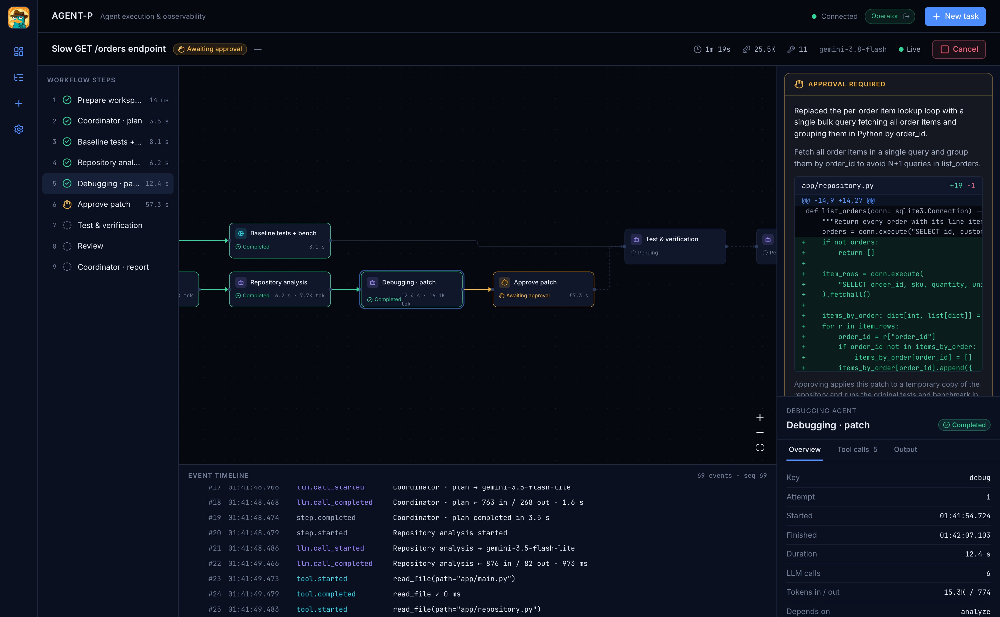
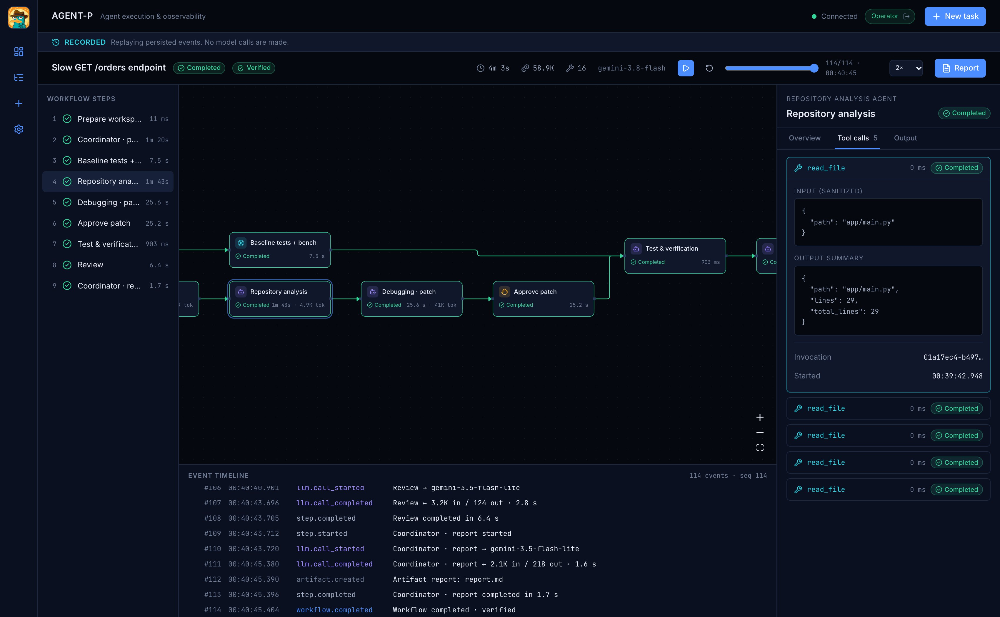
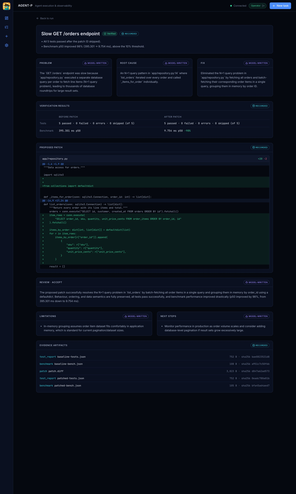
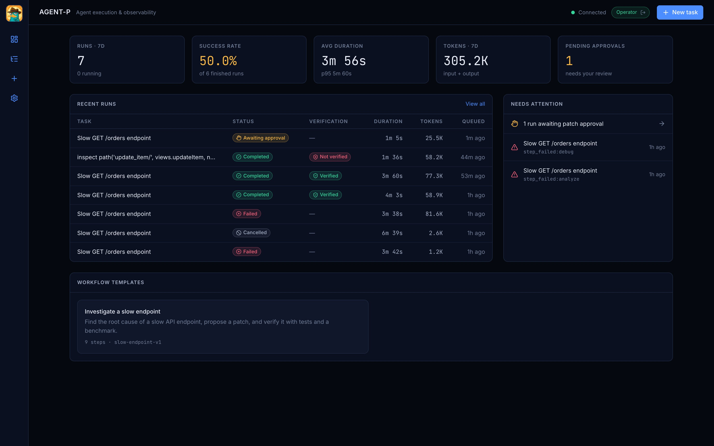
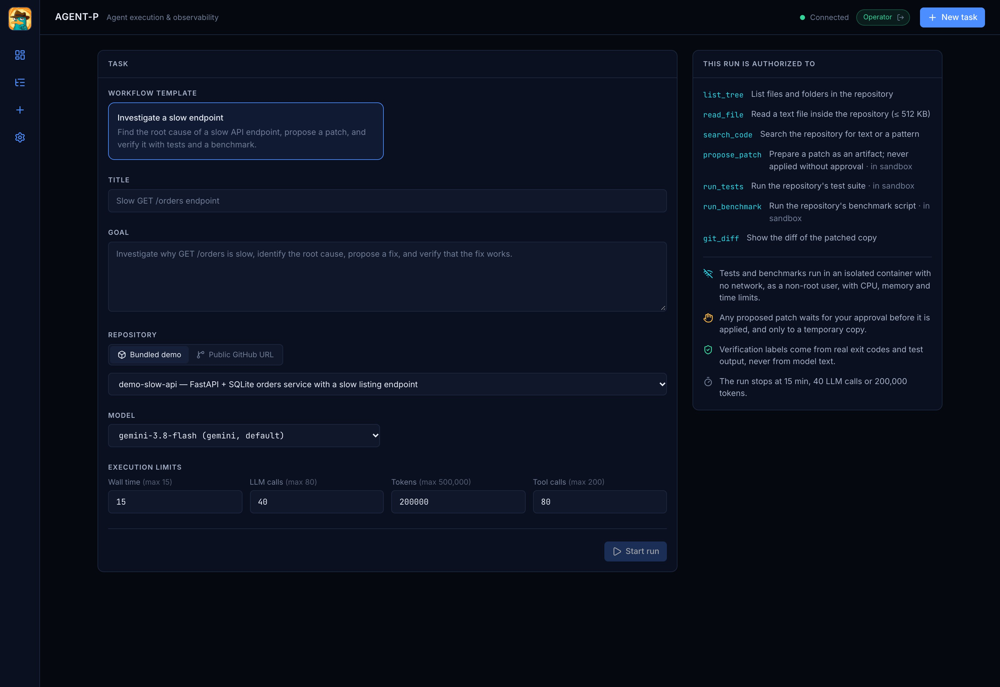
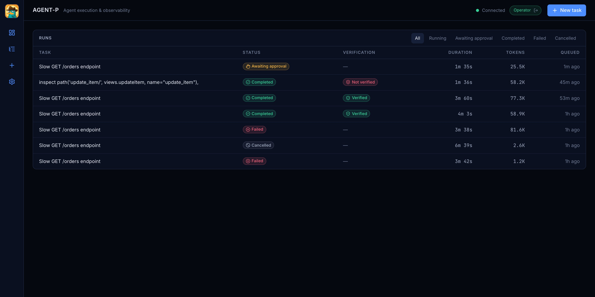
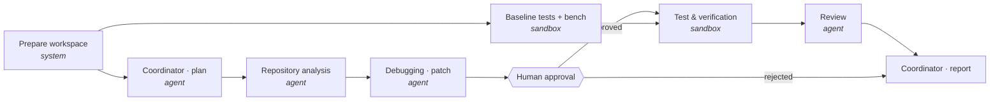
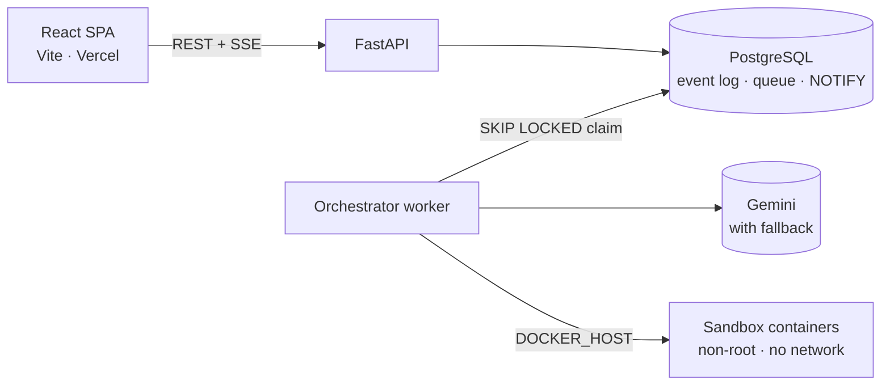

<div align="center">


# AGENT-P

### AI agents you can *watch* — and fixes you can *trust*.

An execution & observability platform where AI agents investigate real code, propose a fix, **wait for your approval**, and **prove** it works with real tests and benchmarks inside an isolated sandbox. Every step is recorded, inspectable, and replayable.

[](https://github.com/AayushAryan007/Agent-P/actions/workflows/ci.yml)




</div>

---

## 😱 The developer nightmare

You ask an AI agent to fix a slow endpoint. A minute later:

> **“Done! I found the issue and fixed it. All tests pass ✅”**

And now the questions start:

- **What did it actually read?** Which files, which lines — or did it guess?
- **What did it run?** Did tests really pass, or did it just *say* they passed?
- **Did it quietly edit the tests** so they'd go green?
- **Did it touch my machine?** Run arbitrary code? Read my `.env`?
- **Is it actually faster?** Says who?
- **Can I see what happened** after the fact — or is it gone with the chat window?

Today's agents are a **black box that grades its own homework**. You either trust it blindly or redo the work yourself.

## 🛡️ How AGENT-P fixes it

| The nightmare | AGENT-P |
|---|---|
| “It says tests pass” | **Verification is computed from real exit codes, JUnit XML and benchmark output** in a sandbox. The model can never upgrade the label. |
| Agent edits the tests to go green | Original tests and benchmarks are **restored before verification**; touching them caps the result at *Partially verified*. |
| Black-box reasoning | Every model turn, tool call, retry, and sandbox run is a **persisted, ordered event** you can inspect live. |
| Arbitrary code on your machine | Code runs only in **non-root, network-less, read-only containers** with CPU/memory/time limits. Secrets never reach them. |
| Agent applies changes on its own | A patch is only a proposal. **Nothing is applied without your explicit approval** — and even then only to a temporary copy. |
| “Trust me, it's faster” | Before/after **benchmark p50** is measured and must beat a threshold to count. |
| Gone when the chat closes | **Deterministic replay** of every run from stored events — at any speed, without calling the model again. |

---

## 🎬 A real run, end to end

This is a recorded run against the bundled `demo-slow-api` repository (FastAPI + SQLite) using **Gemini** — nothing below is mocked.

**1. Agents investigate, live.** A coordinator plans, a repository-analysis agent reads the code through permissioned tools, a debugging agent proposes a patch — and the run **pauses for a human**.



**2. Inspect anything.** Click any step to see its tool calls with sanitized inputs and outputs, tokens, timings, and retries. Completed runs replay from the event log — the banner says it plainly: *no model calls are made*.



**3. Evidence, not claims.** After approval, the patch is applied to a throwaway copy, the **original** tests and benchmark run in the sandbox, and the label is computed from the results. Model-written narrative and recorded facts are visibly separated.

<table>
<tr>
<td width="50%"></td>
<td width="50%">

**What actually happened in this run**

| | Before | After |
|---|---|---|
| Tests | 5 / 5 pass | 5 / 5 pass |
| `list_orders()` p50 | **395.3 ms** | **9.8 ms** |
| Verdict | | ✅ **Verified** (−98%) |

- Root cause found: an **N+1 query** at `app/repository.py:14`
- Fix: one batched query, grouped in memory — ordering and empty orders preserved
- Cost: 17 LLM calls, ~59k tokens on the free tier
- Every number above comes from sandbox output, linked as hashed evidence artifacts

</td>
</tr>
</table>

**4. Operate it like a real system.** Metrics on the dashboard are derived from stored runs — failures included. (Yes, those red rows are real: the free tier returned `503 high demand`, and the run failed *honestly* instead of pretending.)



<details>
<summary><b>More screenshots</b></summary>

**New task — you see exactly what the run is authorized to do before it starts**



**Run history**



</details>

---

## ⚙️ How it works



- The baseline runs **in parallel** with planning and analysis — real concurrency, visible in the graph.
- Agents only act through **typed tools** (`list_tree`, `read_file`, `search_code`, `propose_patch`). A model's tool call is a *request*: the gate checks the allowlist → argument schema → path policy → budget, then executes with a timeout and redacts the output. Denials are recorded too.
- Each agent finishes by calling `submit_result` with a **validated structured output**; invalid output is logged and retried with a bound.

## 🏗️ Architecture



A **modular monolith**: one Python codebase, two processes, and PostgreSQL as both the system of record *and* the coordination layer — no Redis, Celery, or message broker until the requirements justify them.

**Engineering decisions worth a look**

- **The event log is the source of truth.** Each state change and its event commit in one transaction; per-run sequence numbers are assigned under a row lock; a trigger makes `execution_events` append-only.
- **Notify only what's real.** `NOTIFY` is issued inside the same transaction, so the browser can never see an event that was rolled back.
- **Resumable live stream.** SSE with `Last-Event-ID` catch-up from the database; the client reducer drops duplicates by sequence — at-least-once delivery, exactly-once rendering.
- **One reducer for live and replay.** What you replay is exactly what you would have seen live.
- **Crash-safe workers.** Runs are claimed with `FOR UPDATE SKIP LOCKED`, held by database-clock leases, and recovered as `interrupted` if a worker dies.
- **Budgets everywhere.** Wall time (paused while waiting for a human), LLM calls, tokens, tool calls.

Decisions are documented as ADRs: [custom state machine vs LangGraph](docs/ARCHITECTURE_DECISIONS/0001-custom-state-machine-orchestration.md) · [free-tier LLM](docs/ARCHITECTURE_DECISIONS/0002-free-tier-llm-provider.md) · [repository sources](docs/ARCHITECTURE_DECISIONS/0003-repository-sources.md) · [auth](docs/ARCHITECTURE_DECISIONS/0004-single-admin-auth.md) · [SSE](docs/ARCHITECTURE_DECISIONS/0005-sse-for-live-events.md) · [Postgres queue](docs/ARCHITECTURE_DECISIONS/0006-postgres-queue-and-notify.md) · [hosting](docs/ARCHITECTURE_DECISIONS/0007-oci-arm-backend-host.md).

## 🔒 Security model (short version)

- Sandboxes: UID 10001, `--cap-drop=ALL`, `no-new-privileges`, read-only root FS, `--network none` for tests, pids/memory/CPU/time limits, never the Docker socket.
- Path policy blocks traversal, absolute paths, `.git`, and symlinks that escape the repo.
- Repository content is treated as **untrusted data** — prompt injection can't escalate permissions, and the only consequential action needs a human.
- Secrets live only in backend env; logs, events and LLM excerpts pass a redaction filter; the API never returns key values.
- Single-operator auth (argon2 token → signed session, synchronizer CSRF token, Origin allowlist); anonymous visitors can browse and replay public runs.

Residual risks are written down honestly in [SECURITY_MODEL.md](docs/SECURITY_MODEL.md).

## 🧪 Lessons from real runs

Running against a real model surfaced problems no mock would have:

| What happened | What changed |
|---|---|
| `gemini-3.8-flash` returned **503 / 504** under load | Retry once, then switch the run to `gemini-3.5-flash-lite` and **stay there** — every attempt recorded as an event |
| The model copied code into patches with **shifted indentation** | `propose_patch` accepts a block that matches **uniquely** when leading whitespace is ignored, and re-indents the fix; ambiguous matches still fail with a hint |
| Lease timestamps mixed host and VM clocks | Leases use the **database clock** only |
| Double-submit CSRF cookie can't be read cross-site | Switched to a **synchronizer token** bound to the session |

## 🧰 Tech stack

| Layer | Tools |
|---|---|
| Frontend | Vite, React 19, TypeScript (strict), Tailwind v4, React Flow + ELK, TanStack Query, Radix |
| Backend | Python 3.12, FastAPI, Pydantic v2, SQLAlchemy 2 (async), Alembic, sse-starlette, structlog |
| Data | PostgreSQL 16 (`SKIP LOCKED`, `LISTEN/NOTIFY`, append-only trigger) |
| Agents | Gemini via `google-genai`, provider interface (Groq next), typed tools, structured outputs |
| Sandbox | Docker SDK via `DOCKER_HOST` (Colima locally), hardened short-lived containers |
| Quality | pytest (incl. real-container isolation tests), Vitest, ruff, mypy `--strict`, oxlint, GitHub Actions |

## 🚀 Run it locally

Requirements: macOS/Linux, [Colima](https://github.com/abiosoft/colima) or any Docker engine, [uv](https://docs.astral.sh/uv/), Node 20+, a free [Gemini API key](https://aistudio.google.com/apikey).

```bash
git clone https://github.com/AayushAryan007/Agent-P.git
cd Agent-P
colima start
docker compose up -d postgres
docker build -t agentp-sandbox-python:0.1 sandbox/python
```

Backend (terminal 1):

```bash
cd backend
cp .env.example .env
uv run agentp hash-token
uv run alembic upgrade head
uv run agentp api
```

Put `GEMINI_API_KEY` and the printed `ADMIN_TOKEN_HASH` into `backend/.env` first; keep the printed token for signing in.

Worker (terminal 2):

```bash
cd backend
export DOCKER_HOST=unix://$HOME/.colima/default/docker.sock
uv run agentp worker
```

Frontend (terminal 3):

```bash
cd frontend
cp .env.example .env.local
npm install
npm run dev
```

Open http://localhost:5173 → **Sign in** with your token → **Import repo** → start a run → approve the patch → read the report. Full guide: [docs/LOCAL_DEVELOPMENT.md](docs/LOCAL_DEVELOPMENT.md).

## ✅ Tests

```bash
cd backend && uv run pytest
cd frontend && npm test
```

The backend suite covers concurrent event ordering, append-only enforcement, notify-after-commit, SSE resume without duplicates, CSRF/Origin checks, idempotency, approve / reject / cancel / budget / crash-recovery paths, model fallback, the verification rules — and **real sandbox containers** proving UID 10001, blocked network, read-only mounts, absent host secrets, and timeout kills. CI runs all of it on every push.

## 🗺️ Roadmap

- [x] Event log, live SSE stream, replay
- [x] Agents, tool gate, approval gate, sandboxed verification, reports
- [x] Live verified run with Gemini
- [x] Animated landing page with live metrics
- [ ] Public deployment (Vercel + Oracle Cloud free tier)
- [ ] Egress-restricted network for clone/install; gVisor on the host
- [ ] Groq / Ollama providers, cost analytics, 3D execution view
- [ ] Evaluation suite across models and workflows

## 📂 Repository layout

```
backend/        FastAPI API + orchestrator worker (agents, tools, sandbox, events, evaluations)
frontend/       React SPA — landing page, dashboard, live workspace, replay, reports
sandbox/        Hardened container image for running untrusted tests
demo-repos/     Bundled repository with a real, measurable performance bug
docs/           Requirements, architecture, API, database, security model, ADRs
```

## 📚 Documentation

[Product requirements](docs/PRODUCT_REQUIREMENTS.md) · [MVP scope](docs/MVP_SCOPE.md) · [Architecture](docs/ARCHITECTURE.md) · [API](docs/API_SPECIFICATION.md) · [Database](docs/DATABASE_DESIGN.md) · [Security](docs/SECURITY_MODEL.md) · [Design system](docs/DESIGN_SYSTEM.md) · [Roadmap](docs/IMPLEMENTATION_ROADMAP.md)

---

<div align="center">

**Built by [Aayush Aryan](https://github.com/AayushAryan007)** · AI agents should show their work.

</div>
