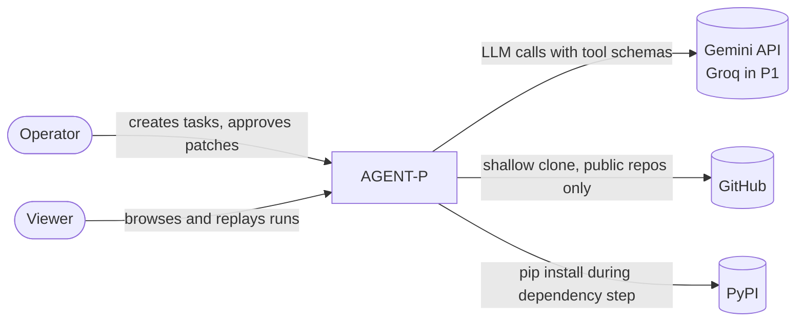
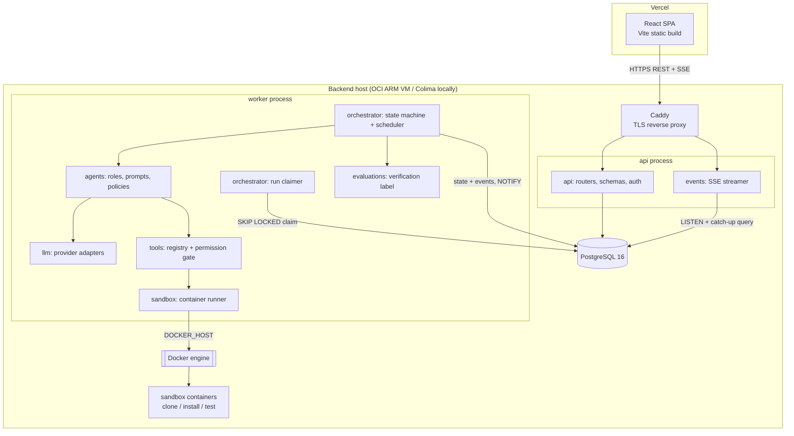
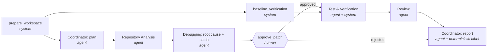
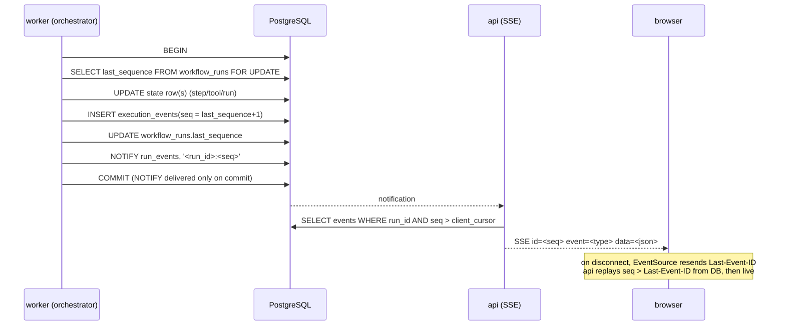
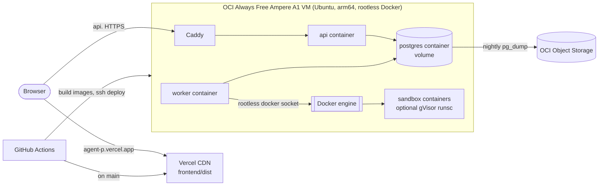

# AGENT-P — Architecture

Status: Phase 2 baseline. Last updated: 2026-10-27.
Related: [TECH_STACK.md](TECH_STACK.md), [DATABASE_DESIGN.md](DATABASE_DESIGN.md), [API_SPECIFICATION.md](API_SPECIFICATION.md), [SECURITY_MODEL.md](SECURITY_MODEL.md), ADRs in [ARCHITECTURE_DECISIONS/](ARCHITECTURE_DECISIONS/).

## 1. Shape of the system

A **modular monolith** in one Python codebase, deployed as two processes:

- **api** — FastAPI: HTTP, auth, validation, SSE streaming. Never executes agent work or untrusted code.
- **worker** — claims queued runs from PostgreSQL and drives them with the orchestrator. Talks to the LLM provider and to the Docker engine (via `DOCKER_HOST`) to launch sandbox containers.

PostgreSQL is the system of record *and* the coordination layer: run queue (`FOR UPDATE SKIP LOCKED`) and event fan-out (`LISTEN/NOTIFY`). No Redis, Celery, or broker in the MVP — see [ADR-0006](ARCHITECTURE_DECISIONS/0006-postgres-queue-and-notify.md).

The frontend is a static Vite SPA on Vercel that talks only to the public API and the SSE stream.

## 2. Diagrams

### 2.1 System context



### 2.2 Containers and components



Cross-cutting modules used by both processes: `persistence` (models, repositories, migrations), `security` (auth, redaction, path policy, audit), `observability` (structlog, correlation IDs; OpenTelemetry in P1), `config`.

### 2.3 Flagship agent workflow (template `slow-endpoint-v1`)



- `baseline_verification` runs tests + benchmark on the unpatched repo **concurrently** with planning/analysis (real parallelism, not decoration).
- The DAG is fixed by the template; the coordinator fills each step's goal and context. It does not invent new steps in the MVP.
- System steps are deterministic functions. They appear in the graph because they consume time and can fail, but they never call the LLM.

### 2.4 Execution event lifecycle



### 2.5 Code execution and approval

```mermaid
sequenceDiagram
  participant D as Debugging agent
  participant T as tool gate
  participant O as orchestrator
  participant U as operator
  participant S as sandbox
  D->>T: propose_patch(edits)
  T->>T: validate schema, paths inside repo, size limits
  T->>T: apply edits as text in memory (no code runs)
  T->>T: applies cleanly → unified diff
  T-->>O: patch artifact
  O->>O: step approve_patch -> waiting_approval, event approval.requested
  U->>O: POST /approvals/{id}/decision {approve}
  O->>S: apply patch to patched copy; restore ORIGINAL tests + bench
  O->>S: run tests + benchmark (network none, limits)
  S-->>O: junit.xml, bench.json, exit codes
  O->>O: compute verification label (deterministic)
```

### 2.6 Deployment topology



ER diagram: see [DATABASE_DESIGN.md](DATABASE_DESIGN.md).

## 3. Request lifecycle

1. **Create task.** `POST /api/v1/tasks` (operator). Pydantic validates the goal, template, repository source (bundled key or GitHub URL regex), and limits against server maximums. The task row is inserted and an `audit_log` row written.
2. **Create run.** `POST /api/v1/tasks/{id}/runs` with `Idempotency-Key`. In one transaction: insert `workflow_runs(status=queued)`, materialize `run_steps` from the template, append event `workflow.created` (seq 1).
3. **Claim.** The worker polls every 1 s (and on `NOTIFY run_queue`): `SELECT … WHERE status='queued' ORDER BY queued_at FOR UPDATE SKIP LOCKED LIMIT 1`. It sets `status=running`, a `lease_expires_at`, and appends `workflow.started`.
4. **Initialize.** The scheduler finds steps whose dependencies are `completed` and starts them as asyncio tasks, bounded by a per-run concurrency limit.
5. **Coordinate.** The coordinator agent receives the task goal plus a deterministic repo summary and returns a typed plan that fills each step's goal.
6. **Agent loop.** Each agent step runs a bounded loop: LLM call → structured output **or** tool calls → tool gate → results back to the model, until a valid final output, budget exhaustion, or timeout.
7. **Tool gate.** For each requested call: lookup in the step's allowlist → validate arguments (Pydantic) → policy checks (paths, sizes, rate) → record `tool.started` → execute (in-process for read-only file tools on the workspace; in a sandbox container for anything that runs code) → truncate and redact output → record `tool.completed`/`tool.failed`.
8. **Persist and stream.** Every state change and its event commit together. NOTIFY wakes the API, which streams from the DB.
9. **Render.** The frontend reduces events into a run state (`reduce(state, event)`). The same reducer powers live view and replay.
10. **Verify.** After approval, the system step applies the patch, restores original tests, runs tests and the benchmark, and computes the verification label deterministically.
11. **Report.** The review and report steps produce artifacts. The run finishes `completed` with a label, or `failed`/`cancelled` with a reason.
12. **Inspect and replay.** `GET /runs/{id}` + `GET /runs/{id}/events?after_seq=` return persisted data only. Replay feeds stored events through the same reducer on a client-side clock.

## 4. State ownership

| Data | Owner | Notes |
|---|---|---|
| Run/step/tool/approval status | Orchestrator (worker) | Written only through `orchestrator.transitions`, which validates the transition table and appends the event in the same transaction |
| Execution events | Orchestrator | Append-only; the authoritative history |
| Current-state rows | Orchestrator | A queryable projection of events, kept consistent by atomic writes |
| Approval decision | API writes `approval_requests.decision` + event | The worker observes and resumes; the API never mutates step state directly |
| Cancel request | API sets `workflow_runs.cancel_requested=true` + event | The worker observes at the next checkpoint and transitions to `cancelled` |
| Dashboard metrics | Derived | SQL aggregates over `workflow_runs` and `llm_calls`; never stored as numbers |
| Graph layout, selection, replay clock | Frontend | Presentation only |

## 5. Module boundaries (backend)

```
backend/app/
  api/            routers, request/response schemas, deps (auth, db session)
  orchestrator/   templates, transitions (state machine), scheduler, worker loop, budgets
  agents/         role definitions: prompt, input/output schemas, allowed tools, limits
  llm/            LLMProvider protocol, gemini adapter, usage accounting, retry/backoff
  tools/          Tool protocol, registry, permission gate, implementations
  sandbox/        container specs, runner (docker SDK via DOCKER_HOST), workspace manager
  events/         event schema (versioned), append, notify, SSE streamer
  persistence/    SQLAlchemy models, repositories, session
  evaluations/    junit/benchmark parsers, verification label rules
  security/       session auth, CSRF/origin checks, redaction, path policy, audit
  observability/  logging setup, correlation IDs
  config.py       pydantic-settings
```

Dependency rule: `api` and `orchestrator` depend on lower modules; `llm`, `tools`, `sandbox` never import `api` or `orchestrator`. Enforced in CI by an import-linter contract.

## 6. Key design discussions

| Topic | MVP choice | Later / at scale |
|---|---|---|
| **Sync vs async** | API returns `202` with the run immediately; work is async in the worker. Python `asyncio` throughout; Docker SDK calls run in a thread pool. | Multiple workers, horizontal |
| **Failure recovery** | Bounded retries per LLM call (rate-limit/backoff), per invalid output (repair prompt, max 2), per tool failure (max 1 for transient). Each attempt is an event. | Configurable retry policies (P1) |
| **Resumability** | Worker lease; on startup, runs with expired leases are marked `failed(reason=interrupted)` and sandboxes cleaned. | Resume from the last completed step using the event log (P2) |
| **Idempotency** | `Idempotency-Key` on create-run and approval decision (stored key → response for 24 h). Approval decision is a conditional update `WHERE status='pending'`. | — |
| **Transaction boundaries** | One transaction per transition: state row(s) + event + sequence bump. LLM and sandbox calls are **never** inside a DB transaction. | — |
| **Event ordering** | Per-run monotonic `sequence_number` assigned under a row lock on `workflow_runs`; unique `(run_id, sequence_number)`. Global order is not needed. | — |
| **Concurrency** | `WORKER_MAX_RUNS=1` on the demo; per-run step concurrency 2; sandbox limits fit the VM. | More workers per host |
| **Rate limiting** | Per-IP limits on auth and create endpoints (in-process token bucket); provider limits handled by backoff with recorded `llm.rate_limited` events. | Redis-backed limiter once there are multiple API instances |
| **Caching** | None beyond HTTP caching of completed-run reads (`ETag`). LLM responses are **not** cached (a cache would blur what really happened). | Prompt caching if the provider supports it |
| **Cost controls** | Per-run budgets: wall time, LLM calls, tokens, tool calls; server-wide daily token cap; free-tier provider. | Cost dashboards (P1) |
| **Observability** | structlog JSON with `run_id`, `step_id`, `trace_id`; `/healthz`, `/readyz`; the event log is itself the product-level trace. | OpenTelemetry traces/metrics export (P1) |
| **Deploy and rollback** | Immutable images tagged with the git SHA; `docker compose pull && up -d`; rollback = redeploy the previous tag. Migrations are additive-only, so the previous version still runs against the new schema. | Blue/green |
| **Horizontal scaling** | Not needed. The design allows it: stateless API (LISTEN per instance), workers use SKIP LOCKED. | Separate sandbox hosts |
| **Data retention** | Sandbox workspaces deleted at run end; cloned repos and large artifacts kept 7 days; events and run metadata kept indefinitely (small). | Configurable per workspace |
