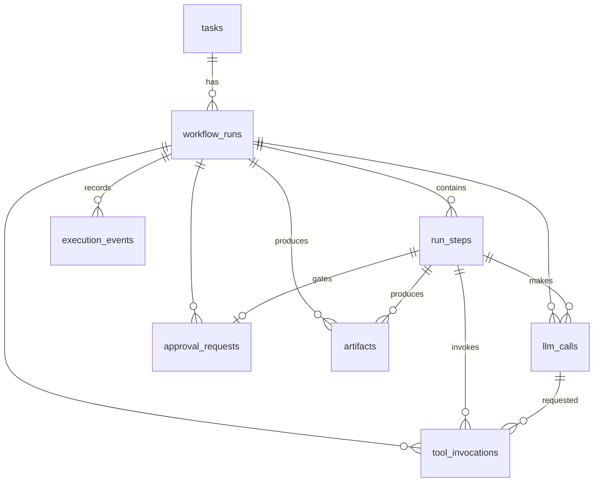

# AGENT-P — Database Design

Status: Phase 2 baseline. Last updated: 2026-10-27. PostgreSQL 16. All IDs are UUIDv7 (time-ordered, generated in the app). All timestamps are `timestamptz` in UTC.

## 1. Entity evaluation

| Candidate (from master prompt) | Decision | Reason |
|---|---|---|
| User | **Deferred (P2)** | Single admin (ADR-0004). `actor` text columns reserve attribution |
| Workspace | **Deferred (P2)** | No multi-tenancy in MVP |
| Task | **Keep** `tasks` | What the user asked; can have many runs |
| WorkflowRun | **Keep** `workflow_runs` | One execution; owns sequence counter, budgets, status |
| WorkflowNode + AgentRun | **Merged** into `run_steps` | Fixed template DAG: each node executes once per run; retries are `attempt`s within the step, recorded as events and in `llm_calls`. Two tables would duplicate status |
| WorkflowEdge | **Folded** into `run_steps.depends_on` (text[] of step keys) | Edges are tiny, immutable per run, and always read with the steps |
| ExecutionEvent | **Keep** `execution_events` | Authoritative, append-only history |
| ToolInvocation | **Keep** `tool_invocations` | Queryable, with sanitized input/output |
| ApprovalRequest | **Keep** `approval_requests` | Needs a conditional, idempotent decision |
| Artifact | **Keep** `artifacts` | Patches, test reports, benchmarks, final report |
| EvaluationResult | **P1** `evaluation_results` | For the eval suite; the run's verification label lives on `workflow_runs` |
| ModelUsage | **Keep** as `llm_calls` | One row per provider call: tokens, latency, status |
| AuditLog | **Keep** `audit_log` | Operator actions |
| (new) | `idempotency_keys`, `app_settings` | API idempotency; server-side defaults |

## 2. ER diagram

## 3. Tables

### tasks
| Column | Type | Notes |
|---|---|---|
| id | uuid PK | |
| title | text | ≤ 120 chars |
| goal | text | ≤ 4,000 chars |
| template_key | text | e.g. `slow-endpoint-v1` |
| repo_source | jsonb | `{"kind":"bundled","key":"demo-slow-api"}` or `{"kind":"github","url":"…","ref":null}` |
| default_model | text | Validated against configured providers |
| limits | jsonb | Validated against server maximums |
| visibility | text | `public` \| `private` |
| created_by | text | `admin` in MVP |
| created_at | timestamptz | |

Index: `(created_at DESC)`.

### workflow_runs
| Column | Type | Notes |
|---|---|---|
| id | uuid PK | |
| task_id | uuid FK → tasks | |
| status | text | `queued`, `running`, `waiting_approval`, `completed`, `failed`, `cancelled` (CHECK) |
| status_reason | text null | e.g. `budget_exceeded:tokens`, `interrupted`, `patch_rejected` |
| verification_label | text null | `verified`, `partially_verified`, `not_verified` |
| model, provider | text | Snapshot at run creation |
| limits | jsonb | Snapshot |
| last_sequence | bigint | Event counter, incremented under row lock |
| cancel_requested | bool | Set by API, observed by worker |
| worker_id, lease_expires_at | text, timestamptz | Claim and lease |
| totals | jsonb | `{llm_calls, input_tokens, output_tokens, tool_calls}`, updated with each transition |
| queued_at, started_at, finished_at | timestamptz | |

Indexes: `(status, queued_at)` partial `WHERE status='queued'`; `(task_id, queued_at DESC)`; `(finished_at DESC)`.

### run_steps
| Column | Type | Notes |
|---|---|---|
| id | uuid PK | |
| run_id | uuid FK | |
| key | text | Unique per run, e.g. `analyze` |
| kind | text | `agent`, `system`, `approval` |
| agent_role | text null | `coordinator`, `repo_analysis`, `debugging`, `verification`, `review` |
| title | text | |
| depends_on | text[] | Keys of upstream steps |
| status | text | `pending`, `running`, `waiting_approval`, `completed`, `failed`, `cancelled`, `skipped` |
| attempt | int | Starts at 1 |
| input, output, error | jsonb | Bounded size (enforced in app) |
| started_at, finished_at | timestamptz | |

Unique `(run_id, key)`. Index `(run_id)`.

### execution_events
| Column | Type | Notes |
|---|---|---|
| id | uuid PK | `event_id` |
| run_id | uuid FK | |
| sequence_number | bigint | Unique with run_id |
| schema_version | smallint | Starts at 1 |
| event_type | text | See API_SPECIFICATION §5 |
| occurred_at | timestamptz | |
| step_id | uuid null | (= `agent_run_id` in the master prompt's terms) |
| tool_invocation_id | uuid null | |
| parent_event_id | uuid null | Causality, e.g. `tool.completed` → `tool.started` |
| payload | jsonb | Redacted, ≤ 32 KB; larger data goes to artifacts and is referenced |

Unique `(run_id, sequence_number)` — this is also the read index. Append-only: no UPDATE/DELETE grants for the app role (enforced by a migration that revokes privileges, plus a trigger).

### tool_invocations
`id, run_id, step_id, llm_call_id null, tool_name, status (started|completed|failed|denied), input jsonb (sanitized), output_summary jsonb, output_truncated bool, error jsonb, trace_id, started_at, finished_at, duration_ms`.
Indexes: `(run_id, started_at)`, `(step_id)`. `denied` records gate rejections — useful evidence of policy working.

### llm_calls
`id, run_id, step_id, attempt, provider, model, status (ok|error|rate_limited|invalid_output), finish_reason, input_tokens, output_tokens, latency_ms, estimated_cost_usd numeric null, request_excerpt jsonb, response_excerpt jsonb, created_at`.
Excerpts are redacted and bounded; full prompts are reconstructable from the agent definition + recorded inputs. Index `(run_id)`, `(created_at)` for dashboards.

### approval_requests
`id, run_id, step_id, kind ('apply_patch'), status (pending|approved|rejected|cancelled), artifact_id (the patch), requested_at, decided_at, decided_by, comment`.
Partial unique index `(step_id) WHERE status='pending'`. Decisions use `UPDATE … WHERE id=$1 AND status='pending'` → 0 rows ⇒ 409.

### artifacts
`id, run_id, step_id, kind (patch|test_report|benchmark|review|report|log), name, content_type, size_bytes, sha256, inline_content jsonb/text null, storage_path text null, created_at, expires_at null`.
Small artifacts (≤ 256 KB) are stored inline; larger ones on disk under `ARTIFACT_ROOT` (object storage later).

### audit_log
`id, occurred_at, actor, action, target_type, target_id, ip, user_agent, details jsonb`. Index `(occurred_at DESC)`.

### idempotency_keys
`key, scope (endpoint), request_hash, response_status, response_body jsonb, created_at`. PK `(scope, key)`. Purged after 24 h.

### app_settings
`key text PK, value jsonb, updated_at, updated_by`. Non-secret defaults only (default model, default limits). **Secrets are never stored in the DB.**

## 4. Lifecycles

- **Run:** `queued → running ⇄ waiting_approval → completed | failed | cancelled`. Terminal states are final.
- **Step:** `pending → running → (waiting_approval) → completed | failed | cancelled`; `skipped` when an upstream branch makes it unnecessary (e.g. verify after rejection).
- **Tool invocation:** `started → completed | failed`, or `denied` directly.
- **Approval:** `pending → approved | rejected | cancelled` (cancelled when the run is cancelled).

Transition tables live in `orchestrator/transitions.py` and are unit tested exhaustively.

## 5. Derived data (not stored)

Dashboard: success rate = completed ÷ terminal runs in the window; average duration = avg(finished_at − started_at); tokens = sum over `llm_calls`; recent failures = runs with status `failed`, ordered by `finished_at`. All computed by SQL views/queries.

## 6. Retention

Events, runs, steps, tool invocations, and llm_calls are kept indefinitely (KB per run). Artifacts with `storage_path` expire after 7 days (inline ones stay). Cloned repo workspaces are deleted at run end. Idempotency keys are deleted after 24 h. Audit log is kept for 1 year.
